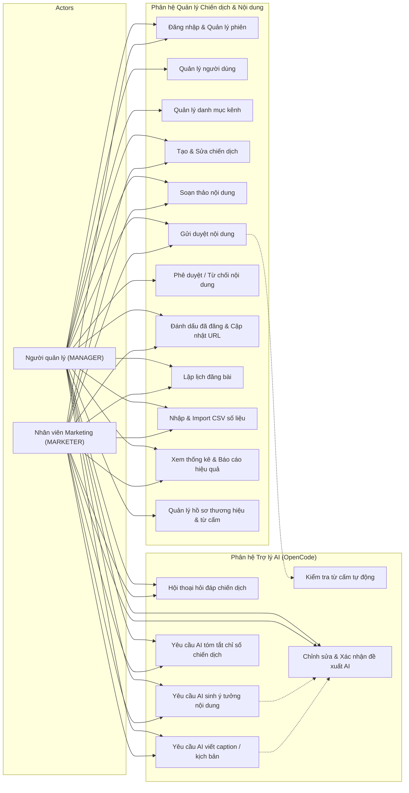
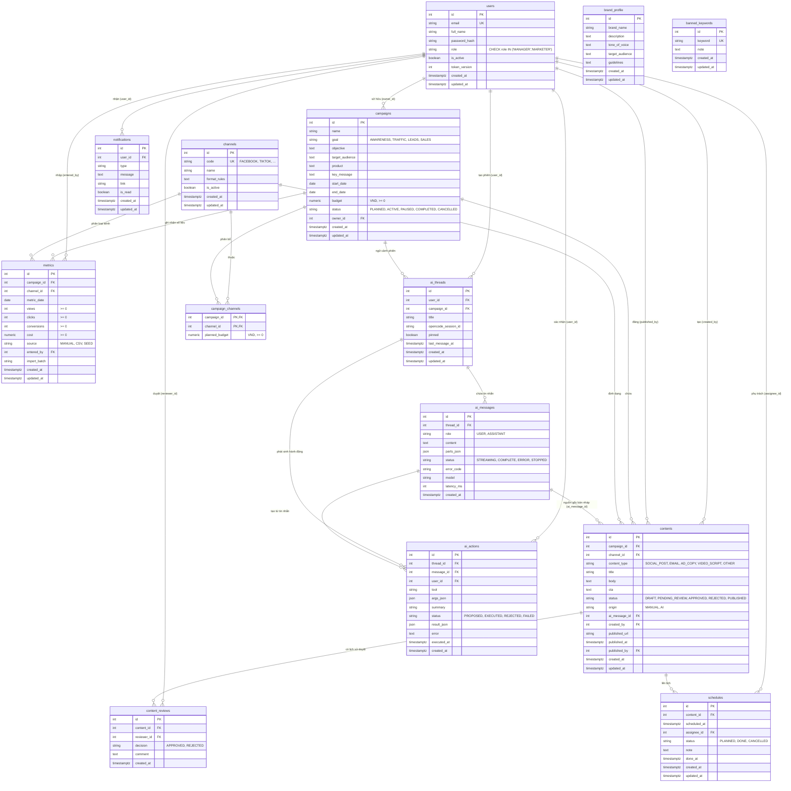
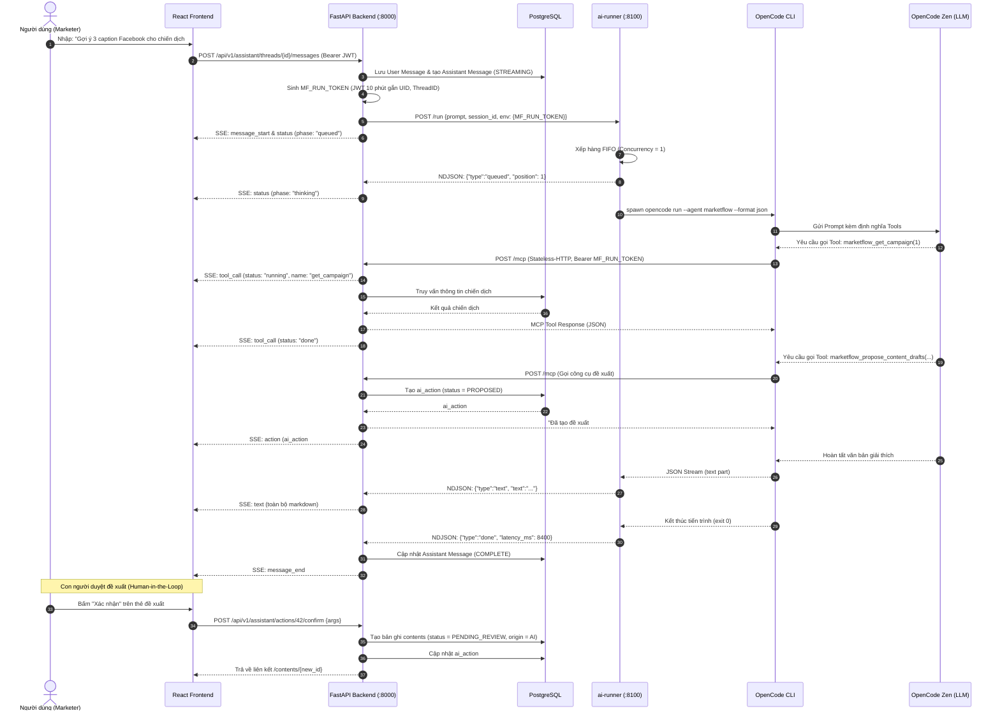

# Tài Liệu Phân Tích Yêu Cầu & Thiết Kế Hệ Thống (KT1)

> Học phần: Ứng dụng trí tuệ nhân tạo (AIA331)  
> Đề tài: Hệ thống quản lý chiến dịch marketing có tích hợp AI (Mã số: 80300)  
> Phiên bản hệ thống: MarketFlow v2 (Clean Rebuild)  
> Ngày lập: 24/10/2026  

---

## 1. Bối cảnh & Mô tả bài toán quản lý

### 1.1. Bối cảnh thực tế
Các doanh nghiệp vừa và nhỏ (SME) tại Việt Nam khi triển khai hoạt động tiếp thị thường phải vận hành đồng thời trên nhiều kênh số (Facebook, TikTok, Instagram, Zalo OA, Email, Google Ads, Website). Tuy nhiên, quy trình quản trị tại các doanh nghiệp này gặp nhiều trở ngại:
- Dữ liệu bị phân mảnh: Kế hoạch chiến dịch ghi trên bảng tính, nội dung lưu trữ rải rác trong file văn bản hoặc tin nhắn, chỉ số đo lường ghi nhận thủ công hoặc không đồng bộ.
- Thiếu quy trình kiểm duyệt: Nhân viên marketing thường tự ý xuất bản bài viết mà thiếu sự phê duyệt của cấp quản lý, dẫn đến rủi ro sai sót thông điệp hoặc vi phạm từ ngữ cấm kỵ của thương hiệu.
- Tốn kém thời gian sáng tạo: Việc xây dựng ý tưởng mới cho từng kênh theo định dạng chuẩn (hook video ngắn, giới hạn ký tự bài đăng, lời kêu gọi hành động) tiêu tốn nhiều nhân lực.
- Khó khăn trong tổng hợp báo cáo: Dữ liệu hiệu quả (lượt xem, lượt nhấp, chuyển đổi, chi phí) không được phân tích tức thời để đưa ra quyết định điều chỉnh ngân sách kịp thời.

### 1.2. Mục tiêu hệ thống
MarketFlow v2 được xây dựng nhằm giải quyết triệt để các vấn đề trên với các mục tiêu cụ thể:
1. Quản lý tập trung vòng đời chiến dịch: Kế hoạch, mục tiêu, ngân sách, kênh truyền thông, nội dung, lịch đăng và chỉ số hiệu quả.
2. Kiểm soát chặt chẽ quy trình phê duyệt nội dung: Tách biệt quyền hạn giữa nhân viên marketing (người tạo) và người quản lý (người duyệt), bắt buộc nội dung phải được duyệt trước khi đăng tải thực tế.
3. Tích hợp AI một cách trung thực và an toàn: Sử dụng Trợ lý AI dựa trên mô hình ngôn ngữ lớn để hỗ trợ lên ý tưởng, viết nháp nội dung theo chuẩn từng kênh, tóm tắt chỉ số và phát hiện từ cấm.
4. Tuân thủ nguyên tắc "Không tính năng ảo" (Rule 0): Toàn bộ số liệu hiển thị dựa trên dữ liệu người dùng nhập hoặc import CSV thật; AI chỉ tạo đề xuất bản nháp (ai_action = PROPOSED) và cần con người bấm xác nhận, không bao giờ tự ý can thiệp vào cơ sở dữ liệu nghiệp vụ.

---

## 2. Người dùng & Phân quyền hệ thống

Hệ thống phân định rõ ràng 2 vai trò người dùng (CONTRACT §2):

| Vai trò | Mã vai trò | Trách nhiệm & Quyền hạn |
|---|---|---|
| **Người quản lý** | `MANAGER` | - Quản lý danh mục người dùng, kênh truyền thông và hồ sơ thương hiệu (Brand Profile).<br>- Toàn quyền xem và quản lý mọi chiến dịch, nội dung, lịch đăng và số liệu.<br>- **Phê duyệt hoặc từ chối nội dung** do nhân viên gửi lên.<br>- **Ràng buộc an toàn:** Người quản lý không được tự duyệt nội dung do chính mình tạo ra (`CANNOT_REVIEW_OWN`). |
| **Nhân viên marketing** | `MARKETER` | - Tạo mới và quản lý các chiến dịch do mình phụ trách (owner).<br>- Soạn thảo nội dung bản nháp, gửi yêu cầu phê duyệt lên cấp quản lý.<br>- Lập kế hoạch lịch đăng bài và cập nhật trạng thái sau khi đã tự đăng thực tế ra kênh ngoài.<br>- Nhập số liệu hiệu quả chiến dịch hàng ngày bằng tay hoặc qua tệp CSV.<br>- Sử dụng Trợ lý AI để sinh bản nháp và nhận gợi ý tối ưu. |

---

## 3. Quy trình nghiệp vụ cốt lõi

### 3.1. Quy trình quản lý chiến dịch & phân bổ ngân sách
1. Nhân viên hoặc Quản lý tạo chiến dịch mới với mục tiêu cụ thể (AWARENESS, TRAFFIC, LEADS, SALES), ngân sách tổng, khoảng thời gian thực hiện, và lựa chọn danh mục kênh tiếp thị kèm ngân sách kế hoạch từng kênh.
2. Hệ thống kiểm tra ràng buộc: Ngày kết thúc không được trước ngày bắt đầu; tổng ngân sách kế hoạch của các kênh không vượt quá ngân sách tổng của chiến dịch.
3. Khi chiến dịch kết thúc hoặc cần dừng, người dùng cập nhật trạng thái (ACTIVE, PAUSED, COMPLETED, CANCELLED). Không cho phép xoá chiến dịch nếu đã phát sinh nội dung hoặc số liệu đo lường.

### 3.2. Quy trình kiểm duyệt nội dung (Content Lifecycle)
Trạng thái nội dung luân chuyển qua một máy trạng thái (state machine) nghiêm ngặt:

```
[DRAFT]  ── (Gửi duyệt: submit) ──>  [PENDING_REVIEW]
   │                                         │
   │ (Người tạo sửa)                  ┌──────┴──────┐
   ▼                                  ▼             ▼
[REJECTED] <── (Từ chối: reject) ──  [ ]      [APPROVED]
   │                                                │
   └── (Sửa lại & gửi lại: submit) ──>              ▼
                                              [PUBLISHED]
```

1. **Khởi tạo (`DRAFT`)**: Nội dung được tạo thủ công bởi Marketer hoặc đề xuất bởi Trợ lý AI (khi đó mang nhãn `origin=AI`).
2. **Gửi duyệt (`submit`)**: Marketer gửi nội dung vào hàng duyệt. Hệ thống tự động đối soát với danh sách từ cấm (`banned_keywords`); nếu có từ vi phạm, hệ thống cảnh báo cụ thể nhưng vẫn cho phép gửi kèm danh sách cảnh báo để Người quản lý xem xét. Trạng thái chuyển sang `PENDING_REVIEW`.
3. **Phê duyệt / Từ chối**:
   - `MANAGER` xem xét nội dung.
   - Nếu đạt yêu cầu: Bấm **Duyệt** (`APPROVED`). Hệ thống ghi nhận lịch sử vào bảng `content_reviews` và gửi thông báo cho người tạo.
   - Nếu chưa đạt: Bấm **Từ chối** (`REJECTED`) và **bắt buộc nhập lý do**. Trạng thái chuyển về `REJECTED`, cho phép người tạo chỉnh sửa và gửi lại.
   - **Ràng buộc:** Nếu `MANAGER` là người tạo nội dung thì không được tự bấm Duyệt; bắt buộc phải do một `MANAGER` khác duyệt.
4. **Đăng bài & Xuất bản (`mark-published`)**: Khi nội dung đã ở trạng thái `APPROVED`, người phụ trách đăng bài thực tế lên nền tảng bên ngoài (Facebook, TikTok...), sau đó quay lại hệ thống bấm **Đã đăng**, cập nhật liên kết bài đăng (`published_url`) và thời điểm đăng (`published_at`). Trạng thái chuyển sang `PUBLISHED` và tự động đánh dấu lịch đăng liên quan hoàn tất (`DONE`).

### 3.3. Quy trình ghi nhận số liệu & import CSV
1. Hàng ngày hoặc định kỳ, nhân viên marketing nhập số liệu hiệu quả (Lượt hiển thị, Lượt nhấp, Lượt chuyển đổi, Chi phí) theo từng chiến dịch, từng kênh và từng ngày.
2. Hệ thống hỗ trợ nhập hàng loạt bằng file CSV với định dạng mẫu chuẩn (`GET /api/v1/metrics/import/template`).
3. Quy trình import gồm 2 bước an toàn:
   - **Xem trước (`preview`)**: Hệ thống đọc tệp (tối đa 2MB, 5.000 dòng), kiểm tra tính hợp lệ từng dòng (kiểm tra định dạng ngày, mã kênh hợp lệ, logic số liệu: Clicks <= Views, Conversions <= Clicks, Cost >= 0) và hiển thị bảng phân loại: số dòng thêm mới, số dòng cập nhật đè.
   - **Xác nhận lưu (`commit`)**: Người dùng xác nhận, hệ thống ghi dữ liệu vào bảng `metrics` với nhãn `source=CSV` và mã lô import (`import_batch`).

---

## 4. Bảng yêu cầu chức năng (Input / Process / Output)

| Mã | Tên chức năng | Dữ liệu đầu vào (Input) | Xử lý nghiệp vụ (Process) | Kết quả đầu ra (Output) |
|---|---|---|---|---|
| **F01** | Đăng nhập hệ thống | Email, Mật khẩu | Kiểm tra tài khoản trong bảng `users`, xác thực mật khẩu bcrypt; kiểm tra rate limit đăng nhập sai (tối đa 5 lần/5 phút). Sinh mã JWT thời hạn 8 giờ. | Token truy cập Bearer JWT, thông tin người dùng (`UserRef`, vai trò). Mã lỗi 401 hoặc 429 nếu vi phạm. |
| **F02** | Quản lý người dùng | Email, Họ tên, Vai trò, Mật khẩu | `MANAGER` thêm mới/khoá tài khoản/đặt lại mật khẩu. Ngăn chặn người dùng tự khoá hoặc tự hạ quyền chính mình. | Bản ghi người dùng cập nhật, thông báo trạng thái. |
| **F03** | Quản lý kênh truyền thông | Mã kênh, Tên kênh, Quy tắc định dạng | Quản lý danh mục 7 kênh chuẩn tiếp thị. Cập nhật quy tắc định dạng ký tự. Xoá kênh có kiểm tra xung đột dữ liệu (`CHANNEL_IN_USE`). | Danh sách kênh tiếp thị kèm quy tắc định dạng cho người và AI. |
| **F04** | Quản lý chiến dịch | Tên, mục tiêu, sản phẩm, đối tượng, thời gian, ngân sách, danh mục kênh | Kiểm tra ràng buộc thời gian (end >= start) và phân bổ ngân sách. Lọc chiến dịch theo giao khoảng thời gian và kênh. | Bản ghi chiến dịch, thống kê tổng chi tiêu và phân bổ nội dung. |
| **F05** | Soạn thảo & gửi duyệt nội dung | Chiến dịch, Kênh, Loại nội dung, Tiêu đề, Thân bài, CTA | Lưu bản ghi `contents` (DRAFT). Khi gửi duyệt, đối soát danh sách từ cấm (`banned_keywords`). Chuyển trạng thái `PENDING_REVIEW`. | Bản ghi nội dung, cảnh báo từ cấm (`banned_matches`), thông báo gửi tới Quản lý. |
| **F06** | Phê duyệt nội dung | Mã nội dung, Quyết định (APPROVED/REJECTED), Lý do | Kiểm tra vai trò `MANAGER`, kiểm tra ràng buộc không tự duyệt bài của mình (`CANNOT_REVIEW_OWN`). Cập nhật trạng thái, ghi log bảng `content_reviews`. | Trạng thái nội dung mới, bản ghi review, thông báo gửi tới người tạo bài. |
| **F07** | Quản lý lịch đăng bài | Mã nội dung, Thời điểm đăng dự kiến, Người phụ trách, Ghi chú | Kiểm tra nội dung phải ở trạng thái hợp lệ. Lọc lịch đăng theo khoảng ngày và nhân sự. Cập nhật trạng thái (PLANNED, DONE, CANCELLED). | Bảng lịch đăng trực quan (Calendar view), liên kết nội dung và chiến dịch. |
| **F08** | Ghi nhận & Import số liệu | File CSV hoặc form nhập tay (Views, Clicks, Conversions, Cost) | Kiểm tra tính logic: Clicks <= Views, Conversions <= Clicks, Cost >= 0. Ghi nhận nhãn nguồn (`MANUAL`, `CSV`, `SEED`). Upsert theo ngày-chiến dịch-kênh. | Bản ghi `metrics` đã lưu, kết quả import phân tách số dòng thêm mới và cập nhật. |
| **F09** | Báo cáo & Thống kê | Bộ lọc: Chiến dịch, Kênh, Khoảng thời gian | Tính toán các chỉ số phái sinh: CTR, CVR, CPC, CPA, CPM, tỷ lệ giải ngân ngân sách. Xử lý mẫu số bằng 0 thành `null` (hiển thị "—"). | Dashboard tổng quan, biểu đồ chuỗi thời gian, báo cáo hiệu quả theo kênh và chiến dịch. |
| **F10** | Quản lý thương hiệu & từ cấm | Tên thương hiệu, Giọng văn, Đối tượng, Hướng dẫn, Danh sách từ cấm | Lưu trữ hồ sơ thương hiệu duy nhất làm ngữ cảnh chuẩn cho toàn bộ hoạt động tiếp thị và Trợ lý AI. Tra cứu và cập nhật từ cấm. | Hồ sơ thương hiệu, danh sách từ cấm được tải vào ngữ cảnh AI. |
| **F11** | Trợ lý AI: Sinh ý tưởng nội dung | Yêu cầu của người dùng, ngữ cảnh chiến dịch đang chọn | AI đọc ngữ cảnh chiến dịch, tạo ý tưởng bám sát mục tiêu. Đề xuất bản nháp qua công cụ `propose_content_drafts`. | Tin nhắn markdown, thẻ đề xuất (`ai_action = PROPOSED`) xuất hiện trên panel bên phải. |
| **F12** | Trợ lý AI: Soạn caption / kịch bản / email | Kênh truyền thông, thông điệp chính, sản phẩm | AI gọi công cụ `get_brand_profile`, áp dụng quy tắc định dạng của kênh (độ dài, hook, hashtag, CTA), tạo bản nháp. | Bản nháp nội dung kèm bộ đếm ký tự so sánh với quy chuẩn kênh; người dùng sửa trước khi bấm Xác nhận. |
| **F13** | Trợ lý AI: Tóm tắt hiệu quả chiến dịch | Yêu cầu tóm tắt chỉ số chiến dịch cụ thể | AI tự động gọi công cụ `get_campaign` hoặc `get_stats` đọc dữ liệu thật từ CSDL, tính toán chỉ số và đề xuất giải pháp tối ưu. Cấm bịa số. | Báo cáo tóm tắt chỉ số dựa trên dữ liệu thật, so sánh hiệu quả giữa các kênh. |
| **F14** | Xác nhận đề xuất AI (Human-in-the-Loop) | Mã đề xuất `ai_action`, tham số người dùng đã chỉnh sửa | Người dùng kiểm tra bản nháp trên panel, sửa lại nội dung nếu cần và bấm **Xác nhận**. Hệ thống thực thi qua Service Layer với quyền của chính người dùng. | Bản ghi nội dung thật được tạo trong bảng `contents` với trạng thái `PENDING_REVIEW` hoặc `DRAFT`. |

---

## 5. Yêu cầu phi chức năng (Non-Functional Requirements)

1. **Bảo mật (Security)**:
   - Mật khẩu người dùng được băm một chiều bằng thuật toán `bcrypt` với 12 rounds.
   - Phiên đăng nhập được quản lý bằng JWT HS256, thời hạn 8 giờ, có cơ chế vô hiệu hoá phiên tức thì khi đăng xuất thông qua `token_version`.
   - Chống tấn công dò mật khẩu (Brute-force): Giới hạn tối đa 5 lần đăng nhập sai trong vòng 5 phút trên mỗi cặp Email/IP.
   - Phân hệ AI Runner chạy dưới tài khoản dịch vụ riêng biệt (`mfai`), bật cấm shell (`bash: deny`), cô lập thư mục chỉ đọc (`SANDBOX_DIR`), không lưu API key của bên thứ ba trong CSDL hay gửi về trình duyệt.
2. **Hiệu năng & Tài nguyên (Performance & Resource Management)**:
   - Tối ưu cho cấu hình máy chủ VPS giới hạn (2 vCPU, 2 GiB RAM):
     + Hàng đợi AI Runner được giới hạn cứng `RUNNER_CONCURRENCY=1` (FIFO queue tối đa 8 requests).
     + Giới hạn tài nguyên systemd cho Runner: `MemoryHigh=768M`, `MemoryMax=896M`, `CPUQuota=180%`.
     + Backend phản hồi các API tra cứu dưới 50ms nhờ đánh chỉ mục CSDL hợp lý.
3. **Tính khả dụng & Độ tin cậy (Availability & Reliability)**:
   - Dịch vụ FastAPI và AI Runner vận hành dưới sự giám sát của `systemd` với cơ chế tự khởi động lại khi có sự cố (`Restart=always`).
   - Có endpoint kiểm tra trạng thái sức khoẻ toàn diện: `GET /api/v1/health` kiểm tra kết nối CSDL và dịch vụ AI Runner.
   - Khi dịch vụ AI gặp lỗi rate-limit từ nhà cung cấp miễn phí, hệ thống tự động fallback sang mô hình dự phòng đã cấu hình (`OPENCODE_FALLBACK_MODELS`) và thông báo lỗi rõ ràng bằng tiếng Việt, không làm sập ứng dụng.
4. **Sao lưu & Khôi phục (Backup & Recovery)**:
   - Hỗ trợ cơ chế sao lưu định kỳ cho PostgreSQL (hoặc file SQLite trong môi trường phát triển) thông qua snapshot hàng ngày.
   - Script nạp dữ liệu mẫu (`seed_demo.py`) có cờ `--reset` cho phép tái thiết lập môi trường thử nghiệm nhanh chóng trong 5 giây.
5. **Trải nghiệm người dùng (UX/UI)**:
   - Giao diện thiết kế theo phong cách tối giản hiện đại (Warm Stone palette), phông chữ chuẩn tiếng Việt Be Vietnam Pro.
   - Hỗ trợ giao diện sáng / tối (Dark Mode) tự động đồng bộ theo hệ điều hành.
   - Tương thích tốt trên màn hình máy tính để bàn và máy tính bảng; các bảng số liệu hỗ trợ phân trang và lọc dữ liệu trực quan.
   - Khu vực Trợ lý AI hiển thị luồng gõ chữ mượt mà (Typing Reveal), hỗ trợ tuỳ chọn giảm chuyển động (`prefers-reduced-motion`) cho người dùng nhạy cảm.

---

## 6. Sơ đồ Use Case & Mô tả Actor

### 6.1. Sơ đồ Use Case tổng thể



---

## 7. Thiết kế Cơ sở dữ liệu (Database Design)

### 7.1. Sơ đồ Quan hệ Thực thể (ERD)

Cơ sở dữ liệu của MarketFlow v2 bao gồm đúng **14 bảng** theo mô hình dữ liệu SQLAlchemy 2.0 (`backend/app/models/`):



### 7.2. Danh mục Bảng dữ liệu & Ràng buộc toàn vẹn

| Tên bảng | Khóa chính (PK) | Khóa ngoại (FK) | Ràng buộc chính (Constraints) |
|---|---|---|---|
| `users` | `id` | Không | `email` UNIQUE, `role IN ('MANAGER', 'MARKETER')`, `token_version >= 0`. |
| `channels` | `id` | Không | `code` UNIQUE (FACEBOOK, INSTAGRAM, TIKTOK, ZALO_OA, EMAIL, GOOGLE_ADS, WEBSITE). |
| `campaigns` | `id` | `owner_id -> users.id` | `CHECK (end_date >= start_date)`, `budget >= 0`, `status IN ('PLANNED','ACTIVE','PAUSED','COMPLETED','CANCELLED')`. |
| `campaign_channels` | `(campaign_id, channel_id)` | `campaign_id -> campaigns.id`<br>`channel_id -> channels.id` | `planned_budget >= 0`. |
| `contents` | `id` | `campaign_id -> campaigns.id`<br>`channel_id -> channels.id`<br>`created_by -> users.id`<br>`published_by -> users.id`<br>`ai_message_id -> ai_messages.id` | `status IN ('DRAFT','PENDING_REVIEW','APPROVED','REJECTED','PUBLISHED')`, `origin IN ('MANUAL','AI')`. |
| `content_reviews` | `id` | `content_id -> contents.id`<br>`reviewer_id -> users.id` | `decision IN ('APPROVED','REJECTED')`, `comment` bắt buộc khi `REJECTED`. |
| `schedules` | `id` | `content_id -> contents.id`<br>`assignee_id -> users.id` | `status IN ('PLANNED','DONE','CANCELLED')`. Nội dung không được ở trạng thái REJECTED hoặc PUBLISHED khi lập lịch. |
| `metrics` | `id` | `campaign_id -> campaigns.id`<br>`channel_id -> channels.id`<br>`entered_by -> users.id` | `UNIQUE(campaign_id, channel_id, metric_date)`. `CHECK (clicks <= views)` (khi views > 0), `CHECK (conversions <= clicks)` (khi clicks > 0), `cost >= 0`. |
| `brand_profile` | `id` | Không | Bản ghi cấu hình đơn lập (singleton). |
| `banned_keywords` | `id` | Không | `keyword` UNIQUE (lưu chữ thường). |
| `notifications` | `id` | `user_id -> users.id` | Đánh chỉ mục `(user_id, is_read)`. |
| `ai_threads` | `id` | `user_id -> users.id`<br>`campaign_id -> campaigns.id` | Đánh chỉ mục `user_id`, hỗ trợ ghim (`pinned`) và tìm kiếm. |
| `ai_messages` | `id` | `thread_id -> ai_threads.id` | `role IN ('USER','ASSISTANT')`, `status IN ('STREAMING','COMPLETE','ERROR','STOPPED')`. |
| `ai_actions` | `id` | `thread_id -> ai_threads.id`<br>`message_id -> ai_messages.id`<br>`user_id -> users.id` | `status IN ('PROPOSED','EXECUTED','REJECTED','FAILED')`. Lưu đầy đủ tham số đầu vào và kết quả thực thi. |

---

## 8. Kiến trúc hệ thống & Luồng dữ liệu chính

### 8.1. Sơ đồ kiến trúc phân tầng

```mermaid
flowchart TD
    Client["Trình duyệt người dùng (React 18 + Vite SPA)"]
    
    subgraph Host["Máy chủ VPS (Ubuntu 24.04 LTS)"]
        subgraph NginxWeb["Reverse Proxy (Nginx, Port 8080)"]
            Static["Frontend Tĩnh (/dist)"]
            ProxyAPI["Proxy /api/v1 -> 127.0.0.1:8000"]
        end

        subgraph BackendLayer["FastAPI Backend (marketflow-api, Port 8000)"]
            Routers["REST Routers (/api/v1/*)"]
            AuthMiddle["JWT Auth & Rate Limiter"]
            Services["Service Layer (Nghiệp vụ & Phân quyền)"]
            MCPServer["MCP Streamable-HTTP Server (/mcp)"]
        end

        subgraph DBLayer["PostgreSQL 16 (127.0.0.1:5432)"]
            DB[(marketflow DB)]
        end

        subgraph RunnerLayer["ai-runner Service (Port 8100, user: mfai)"]
            RunnerAPI["FastAPI Runner (/run, /health)"]
            QueueMgr["Hàng đợi FIFO (Concurrency = 1)"]
            ProcMgr["Process Group & Timeout Manager"]
            OpenCodeCLI["OpenCode CLI Subprocess"]
        end
    end

    subgraph CloudLayer["OpenCode Zen Cloud"]
        LLM["Mô hình miễn phí (big-pickle / glm-5.3-flash-free)"]
    end

    Client -->|HTTPS / WSS| NginxWeb
    ProxyAPI --> BackendLayer
    Routers --> AuthMiddle --> Services --> DB
    Services --> MCPServer

    Routers -->|POST /run (NDJSON Stream)| RunnerAPI
    RunnerAPI --> QueueMgr --> ProcMgr --> OpenCodeCLI
    OpenCodeCLI -->|Gọi model| LLM
    OpenCodeCLI -->|Gọi ngược MCP Tools (/mcp + RunToken)| MCPServer
    MCPServer --> Services
```

### 8.2. Luồng thực thi Trợ lý AI (Sequence Diagram)

Sơ đồ trình bày luồng dữ liệu end-to-end khi người dùng yêu cầu AI viết bài và tạo đề xuất:



---

## 9. Vị trí ứng dụng AI & Lý do lựa chọn

Trong kiến trúc tổng thể, AI được tích hợp tại một vị trí tập trung duy nhất (**Khu vực Trợ lý AI - `/assistant`**) thay vì phân mảnh khắp ứng dụng. 

**Lý do lựa chọn vị trí này:**
1. **Minh bạch về mặt ranh giới**: Người dùng luôn nhận thức rõ đang giao tiếp với một thực thể AI, tránh gây nhầm lẫn với các tính năng quản lý tự động theo quy tắc.
2. **Kiểm soát bảo mật tập trung (Centralized Security Boundary)**: Toàn bộ tương tác AI đi qua một điểm kiểm soát duy nhất (ai-runner + MCP server), dễ dàng áp dụng chính sách kiểm tra quyền hạn và chống injection.
3. **Phù hợp với đặc thù LLM**: Mô hình ngôn ngữ lớn hoạt động tốt nhất dưới dạng một trợ lý hội thoại có ngữ cảnh liên tục, có thể tra cứu thông tin đa chiều và hỗ trợ thảo luận chỉnh sửa qua nhiều lượt trao đổi.

---

## 10. Thiết kế Prompt sơ bộ & Hướng gọi AI

### 10.1. Cấu trúc System Prompt
Được định nghĩa tại `deploy/opencode/agent/marketflow.md`:
- **Định danh vai trò**: Trợ lý Marketing AI của hệ thống MarketFlow, phục vụ doanh nghiệp vừa và nhỏ (SME) tại Việt Nam.
- **Nhiệm vụ giới hạn (3 việc)**:
  1. Gợi ý ý tưởng nội dung bám sát mục tiêu chiến dịch.
  2. Soạn nháp bài viết / kịch bản / email theo quy chuẩn định dạng từng kênh.
  3. Tóm tắt số liệu hiệu quả và đưa ra gợi ý tối ưu thiết thực.
- **Rào chắn bắt buộc (Guardrails)**:
  - Cấm tự bịa đặt số liệu (Grounding constraint); chỉ sử dụng dữ liệu do công cụ trả về.
  - Cấm tuyên bố đã đăng bài hay đã duyệt bài; luôn giải thích rõ mọi thao tác ghi dữ liệu chỉ là đề xuất (`PROPOSED`) và cần người dùng bấm xác nhận trên giao diện.
  - Không sử dụng các từ ngữ cấm kỵ hoặc cam kết sai sự thật.
  - Cấm truy cập internet hoặc hệ thống máy chủ bên ngoài.

### 10.2. Cấu trúc User Prompt mẫu & Ngữ cảnh truyền vào
Mỗi lượt gọi, Backend tự động bổ sung khối `[NGỮ CẢNH]` phía trên câu hỏi của người dùng:

```
[NGỮ CẢNH]
Người dùng: Trần Thị Lan Anh (MARKETER)
Ngày hiện tại: 2026-10-24 (Giờ Việt Nam)
Chiến dịch liên kết: #1 - Ra Mắt Dòng Cold Brew Đóng Chai Tiện Lợi (Mục tiêu: SALES)
Danh mục kênh khả dụng: FACEBOOK, INSTAGRAM, TIKTOK, ZALO_OA, EMAIL, GOOGLE_ADS, WEBSITE

[YÊU CẦU CỦA NGƯỜI DÙNG]
Hãy tóm tắt hiệu quả của chiến dịch tuần qua và gợi ý 2 ý tưởng bài đăng Facebook thúc đẩy doanh số.
```

---

## 11. Kế hoạch triển khai các giai đoạn tiếp theo

Dựa trên kết quả phân tích thiết kế KT1, kế hoạch triển khai được phân bổ như sau:

| Giai đoạn | Nội dung trọng tâm | Tiêu chí nghiệm thu |
|---|---|---|
| **KT2: Xây dựng lõi nghiệp vụ** | - Cài đặt CSDL PostgreSQL / SQLite với SQLAlchemy 2.0 & Alembic.<br>- Xây dựng xác thực JWT, phân quyền 2 vai trò (`MANAGER`, `MARKETER`).<br>- Hoàn thiện CRUD Chiến dịch, Kênh, Nội dung, Lịch đăng, Số liệu.<br>- Xây dựng bộ lọc thời gian giao khoảng và import CSV số liệu.<br>- Xây dựng giao diện React chuẩn phong cách Warm Stone. | - Vượt qua 100% bộ kiểm thử tự động Backend (Pytest).<br>- Frontend typecheck strict và lint 0 lỗi.<br>- Seed dữ liệu mẫu chạy thành công. |
| **KT3: Tích hợp Trợ lý AI & Tối ưu Prompt** | - Triển khai dịch vụ nội bộ `ai-runner` (FastAPI + systemd).<br>- Tích hợp MCP Streamable-HTTP Server với Bearer Run-Token.<br>- Xây dựng luồng sự kiện SSE trực tiếp từ Backend tới Browser.<br>- Thiết kế và tối ưu Prompt qua 3 phiên bản (v1 -> v2 -> v3).<br>- Xây dựng panel "Đề xuất & bản nháp" (Human-in-the-Loop). | - Vượt qua bộ kiểm tra harness self-test (`evaluate_assistant.py --dry-run`).<br>- Khóa bảo mật theo cấu hình spike P0 trước các kịch bản Prompt Injection. |
| **Cuối kỳ: Triển khai VPS & Đóng gói sản phẩm** | - Triển khai hệ thống lên máy chủ VPS thực tế qua Cloudflare Tunnel.<br>- Cấu hình giới hạn bộ nhớ systemd và bảo vệ tài nguyên.<br>- Đóng gói Docker Compose hoàn chỉnh.<br>- Hoàn thiện bộ tài liệu kỹ thuật và kịch bản demo bảo vệ. | - Hệ thống trực tuyến ổn định tại `marketing.kienhieu.id.vn`.<br>- Báo cáo kỹ thuật và minh chứng SDLC đầy đủ. |
